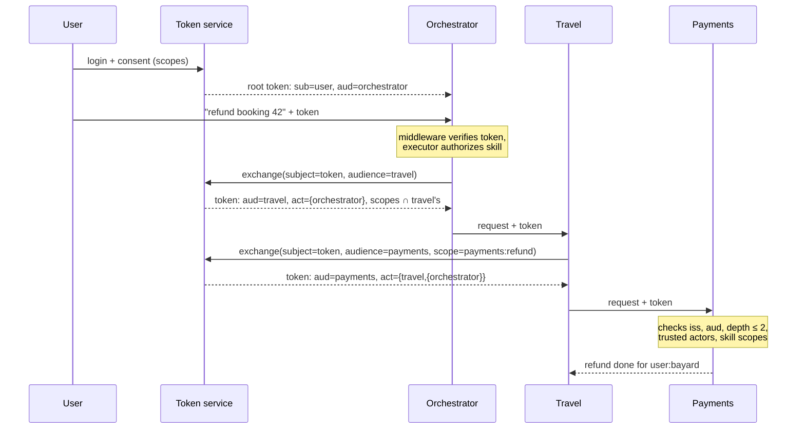

# A2A Delegation Extension

Every A2A request carries a verifiable chain of **who it is for** and
**who has handled it**. Authority can only **shrink** at each hop, and it is
enforced in middleware **before any model runs**.

- Spec: [`v1.md`](v1.md)
- Code: [`src/a2a/extensions/delegation/`](../../../src/a2a/extensions/delegation/)
- Demo: [`samples/delegation_demo.py`](../../../samples/delegation_demo.py)

## How it works



## Wiring an agent

```python
from a2a.extensions.delegation import DelegationParams, delegation_extension
from a2a.extensions.delegation.server import (
    DelegationContextBuilder, JwksKeySource, authorize_skill, delegation_middleware,
)

params = DelegationParams(
    issuer='https://sts.example.com',
    token_endpoint='https://sts.example.com/token',
    jwks_uri='https://sts.example.com/.well-known/jwks.json',
    audience='agent:payments',
    max_chain_depth=2,
    skill_scopes={'refund': frozenset({'payments:refund'})},
    trusted_actors=frozenset({'agent:orchestrator', 'agent:travel'}),
)
card.capabilities.extensions.append(delegation_extension(params))

app = Starlette(
    routes=[*create_agent_card_routes(agent_card=card),
            *create_jsonrpc_routes(handler, rpc_url='/',
                                   context_builder=DelegationContextBuilder())],
    middleware=[delegation_middleware(params, JwksKeySource(params.jwks_uri, http))],
)

# In the executor, before performing a skill:
principal = authorize_skill(context.call_context, params, 'refund')

# To call the next agent on the user's behalf:
client = factory.create(next_card, interceptors=[DelegationInterceptor(exchanger)])
await client.send_message(request, context=forward_context(principal))
```

## Attacks the demo shows being stopped

Run `uv run python -m samples.delegation_demo`. The same scenarios run as
tests in `tests/extensions/delegation/test_demo.py`.

| Scenario | Stopped by | Result |
|---|---|---|
| User never granted refunds | Per-skill scope check at the first hop | Task `REJECTED` |
| Prompt-injected refund with a read-only token | `authorize_skill` is code, not model output | Task `REJECTED` |
| Compromised travel agent replays its token at payments (confused deputy) | Audience binding | `401 wrong_audience` |
| Rogue agent re-exchanges a stolen token | Only the token's audience may exchange it | `invalid_grant` |
| Agent requests a scope the user never delegated | Scopes never widen | `invalid_scope` |
| 3-hop chain reaches an agent allowing 2 | `max_chain_depth` | `403 chain_too_deep` |
| Registered but untrusted agent in the chain | `trusted_actors` | `403 untrusted_actor` |
| Token signed with an attacker's key | ES256 signature against the issuer's JWKS | `401 invalid_token` |
| Card points callers at an attacker's token endpoint | Client is pinned to its own STS | `untrusted_issuer`, no request sent |
| *Without DPoP:* intercepted token replayed | Nothing (known gap of bearer tokens) | Succeeds until expiry |
| *With DPoP:* stolen token used as Bearer or with the attacker's key | `cnf.jkt` binding + proof | `401 invalid_dpop_proof` |
| *With DPoP:* whole request (token + proof) captured and resent | Proof `jti` replay cache | `401 invalid_dpop_proof` |

## Sender-constrained tokens (DPoP)

Set `dpop_required=True` on an agent, give each agent a key, and sign its
outbound requests:

```python
key = DPoPKey.generate()
http = httpx.AsyncClient(auth=DPoPSigner(key))          # signs every DPoP request
exchanger = TokenExchangeClient(..., http=http, dpop_key=key)  # STS binds tokens to key
```

Each exchange binds the new token to the *calling* agent's key, and every
request carries a fresh proof for its exact method and URL. Share the
middleware's `ReplayCache` across replicas in production.
